  <h1>Gabriel Cordeiro</h1>
  
<b>Desenvolvedor Full Stack · Web & Mobile</b>

  
TypeScript · Node.js · NestJS · React · React Native · Kotlin Multiplatform

  
  
  
  

---

## Sobre mim

Desenvolvedor **Full Stack** com foco em **Mobile** e **Back-end**. Construo produtos de ponta a ponta: **APIs REST** em **Node.js/NestJS** e **PHP/Laravel**, interfaces em **React** e **Next.js**, e apps **Android e iOS** com **React Native (Expo)** e **Kotlin Multiplatform**, sempre em **TypeScript** quando possível.

No dia a dia trabalho com **plataformas de mobilidade urbana** em produção (apps de motorista e passageiro, painéis administrativos e APIs) e mantenho produtos próprios: duas **extensões open source para VS Code**, um **assistente de IA no WhatsApp** e um **app Android publicado na Play Store**.

Valorizo **arquitetura de software**, **Clean Code**, **SOLID**, **design patterns**, **testes automatizados** (100% de cobertura nos meus projetos), **CI/CD** e **performance**.

 

---

## Stack

  

---

## Projetos em destaque

<table>
  <tr>
    <td align="center" valign="top" width="50%">
       
      
      <h3>Reflect for Android</h3>
      <b>EXTENSÃO VS CODE · OPEN SOURCE</b>
      
  

      
Espelha e controla um celular Android real dentro do VS Code, sem emulador. Inspector de componentes React Native igual ao DevTools do navegador, print e gravação de tela.

      <b>INSTALAR NO</b>   <a href="https://open-vsx.org/extension/GabrielCordeiro/reflect-android"><img src="https://img.shields.io/badge/Antigravity-1A1A1A?style=for-the-badge&logo=data:image/svg%2bxml;base64,PHN2ZyB3aWR0aD0iMTIwIiBoZWlnaHQ9IjEyMCIgdmlld0JveD0iMCAwIDEzNiAxMzYiIGZpbGw9Im5vbmUiIHhtbG5zPSJodHRwOi8vd3d3LnczLm9yZy8yMDAwL3N2ZyI+IDxnIHRyYW5zZm9ybT0idHJhbnNsYXRlKDEyIDEwKSI+IDxwYXRoIGQ9Ik04OS42OTkyIDkzLjY5NUM5NC4zNjU5IDk3LjE5NSAxMDEuMzY2IDk0Ljg2MTcgOTQuOTQ5MiA4OC40NDVDNzUuNjk5MiA2OS43NzgzIDc5Ljc4MjUgMTguNDQ1IDU1Ljg2NTkgMTguNDQ1QzMxLjk0OTIgMTguNDQ1IDM2LjAzMjUgNjkuNzc4MyAxNi43ODI1IDg4LjQ0NUM5Ljc4MjUxIDk1LjQ0NSAxNy4zNjU4IDk3LjE5NSAyMi4wMzI1IDkzLjY5NUM0MC4xMTU5IDgxLjQ0NSAzOC45NDkyIDU5Ljg2MTcgNTUuODY1OSA1OS44NjE3QzcyLjc4MjUgNTkuODYxNyA3MS42MTU5IDgxLjQ0NSA4OS42OTkyIDkzLjY5NVoiIGZpbGw9IiMzMTg2RkYiLz4gPG1hc2sgaWQ9ImFnX2Zhdl9tIiBzdHlsZT0ibWFzay10eXBlOmFscGhhIiBtYXNrVW5pdHM9InVzZXJTcGFjZU9uVXNlIiB4PSIxMyIgeT0iMTgiIHdpZHRoPSI4NSIgaGVpZ2h0PSI3OCI+IDxwYXRoIGQ9Ik04OS42OTkyIDkzLjY5NUM5NC4zNjU5IDk3LjE5NSAxMDEuMzY2IDk0Ljg2MTcgOTQuOTQ5MiA4OC40NDVDNzUuNjk5MiA2OS43NzgzIDc5Ljc4MjUgMTguNDQ1IDU1Ljg2NTkgMTguNDQ1QzMxLjk0OTIgMTguNDQ1IDM2LjAzMjUgNjkuNzc4MyAxNi43ODI1IDg4LjQ0NUM5Ljc4MjUxIDk1LjQ0NSAxNy4zNjU4IDk3LjE5NSAyMi4wMzI1IDkzLjY5NUM0MC4xMTU5IDgxLjQ0NSAzOC45NDkyIDU5Ljg2MTcgNTUuODY1OSA1OS44NjE3QzcyLjc4MjUgNTkuODYxNyA3MS42MTU5IDgxLjQ0NSA4OS42OTkyIDkzLjY5NVoiIGZpbGw9ImJsYWNrIi8+IDwvbWFzaz4gPGcgbWFzaz0idXJsKCNhZ19mYXZfbSkiPiA8ZyBmaWx0ZXI9InVybCgjYWdfZmF2X2YwKSI+PGVsbGlwc2UgY3g9IjIyLjc4NzMiIGN5PSIyNi44MDk4IiByeD0iMjIuNzg3MyIgcnk9IjI2LjgwOTgiIHRyYW5zZm9ybT0ibWF0cml4KC0wLjExMjc4NCAwLjk5MzYyIC0wLjk5MzYyIC0wLjExMjc4MSA2Ni4yNDczIC0xNS41MzQ0KSIgZmlsbD0iI0ZGRTQzMiIvPjwvZz4gPGcgZmlsdGVyPSJ1cmwoI2FnX2Zhdl9mMSkiPjxlbGxpcHNlIGN4PSI5Ni40OTEiIGN5PSIzNS4xMjMxIiByeD0iMjkuNTAwNyIgcnk9IjMwLjE0OTIiIHRyYW5zZm9ybT0icm90YXRlKDc2LjkyNDMgOTYuNDkxIDM1LjEyMzEpIiBmaWxsPSIjRkM0MTNEIi8+PC9nPiA8ZyBmaWx0ZXI9InVybCgjYWdfZmF2X2YyKSI+PGVsbGlwc2UgY3g9IjkuMDI5ODgiIGN5PSI0MS42NjQ3IiByeD0iMzAuODMyIiByeT0iMzkuOTQxNyIgdHJhbnNmb3JtPSJyb3RhdGUoNzQuMTI1NyA5LjAyOTg4IDQxLjY2NDcpIiBmaWxsPSIjMDBCOTVDIi8+PC9nPiA8ZyBmaWx0ZXI9InVybCgjYWdfZmF2X2YzKSI+PGVsbGlwc2UgY3g9IjExLjIyMTIiIGN5PSI0Mi44OTE1IiByeD0iMzAuMjIiIHJ5PSIzMy4yNjk1IiB0cmFuc2Zvcm09InJvdGF0ZSg0NS42MDY1IDExLjIyMTIgNDIuODkxNSkiIGZpbGw9IiMwMEI5NUMiLz48L2c+IDxnIGZpbHRlcj0idXJsKCNhZ19mYXZfZjQpIj48ZWxsaXBzZSBjeD0iNzUuNzU0NiIgY3k9IjEwNC44MjIiIHJ4PSIyOS4wMTc3IiByeT0iMjcuOTQzIiB0cmFuc2Zvcm09InJvdGF0ZSg3Ni45MjQzIDc1Ljc1NDYgMTA0LjgyMikiIGZpbGw9IiMzMTg2RkYiLz48L2c+IDxnIGZpbHRlcj0idXJsKCNhZ19mYXZfZjUpIj48ZWxsaXBzZSBjeD0iMzMuNTY2MSIgY3k9IjM1LjQwNDMiIHJ4PSIzMy41NjYxIiByeT0iMzUuNDA0MyIgdHJhbnNmb3JtPSJtYXRyaXgoLTAuNDA5NTM5IDAuOTEyMjkzIC0wLjkxMjI5NCAtMC40MDk1MzcgMTAxLjI1IC0xNS4xNjc0KSIgZmlsbD0iI0ZCQkMwNCIvPjwvZz4gPGcgZmlsdGVyPSJ1cmwoI2FnX2Zhdl9mNikiPjxwYXRoIGQ9Ik0yLjU2ODAyIDE0OS42OTVDLTE1LjgxMTYgMTQyLjQ4IDE1LjU5ODcgODMuMTE2MyAyMy40MDkzIDYzLjIyMDNDMzEuMjIgNDMuMzI0NCA1Mi40NTE0IDMzLjA0NDcgNzAuODMxIDQwLjI2Qzg5LjIxMDcgNDcuNDc1MyAxMTAuOTk2IDg3LjIxNjIgMTAzLjE4NSAxMDcuMTEyQzk1LjM3NDIgMTI3LjAwOCAyMC45NDc3IDE1Ni45MSAyLjU2ODAyIDE0OS42OTVaIiBmaWxsPSIjMzE4NkZGIi8+PC9nPiA8ZyBmaWx0ZXI9InVybCgjYWdfZmF2X2Y3KSI+PHBhdGggZD0iTTExMy45MzQgNzUuODA3OUMxMDkuMDEzIDgxLjU1MDkgOTYuMTcyNCA3OC42MjI0IDg1LjI1MyA2OS4yNjY3Qzc0LjMzMzUgNTkuOTExIDY5LjQ3MDQgNDcuNjcxMSA3NC4zOTEgNDEuOTI4Qzc5LjMxMTYgMzYuMTg1IDkyLjE1MjUgMzkuMTEzNiAxMDMuMDcyIDQ4LjQ2OTJDMTEzLjk5MSA1Ny44MjQ5IDExOC44NTUgNzAuMDY0OCAxMTMuOTM0IDc1LjgwNzlaIiBmaWxsPSIjNzQ5QkZGIi8+PC9nPiA8ZyBmaWx0ZXI9InVybCgjYWdfZmF2X2Y4KSI+PGVsbGlwc2UgY3g9IjkyLjYxMSIgY3k9IjIzLjc5NjIiIHJ4PSI0NC4yNDExIiByeT0iMjcuNTAxNiIgdHJhbnNmb3JtPSJyb3RhdGUoMzQuMDc2MyA5Mi42MTEgMjMuNzk2MikiIGZpbGw9IiNGQzQxM0QiLz48L2c+IDxnIGZpbHRlcj0idXJsKCNhZ19mYXZfZjkpIj48ZWxsaXBzZSBjeD0iMjMuNDk0OSIgY3k9IjI5LjU4ODciIHJ4PSIyMy43MDcxIiByeT0iMTMuNzg2OSIgdHJhbnNmb3JtPSJyb3RhdGUoMTEyLjUxNiAyMy40OTQ5IDI5LjU4ODcpIiBmaWxsPSIjRkZFRTQ4Ii8+PC9nPiA8L2c+IDwvZz4gPGRlZnM+IDxmaWx0ZXIgaWQ9ImFnX2Zhdl9mMCIgeD0iMi40OTM0OCIgeT0iLTI2LjU0MjMiIHdpZHRoPSI2OS4wODk5IiBoZWlnaHQ9IjYxLjI1MjUiIGZpbHRlclVuaXRzPSJ1c2VyU3BhY2VPblVzZSIgY29sb3ItaW50ZXJwb2xhdGlvbi1maWx0ZXJzPSJzUkdCIj48ZmVHYXVzc2lhbkJsdXIgc3RkRGV2aWF0aW9uPSIzLjg5MDM0Ii8+PC9maWx0ZXI+IDxmaWx0ZXIgaWQ9ImFnX2Zhdl9mMSIgeD0iMjguNzUyNCIgeT0iLTMyLjAzMzMiIHdpZHRoPSIxMzUuNDc3IiBoZWlnaHQ9IjEzNC4zMTMiIGZpbHRlclVuaXRzPSJ1c2VyU3BhY2VPblVzZSIgY29sb3ItaW50ZXJwb2xhdGlvbi1maWx0ZXJzPSJzUkdCIj48ZmVHYXVzc2lhbkJsdXIgc3RkRGV2aWF0aW9uPSIxOC44MDc4Ii8+PC9maWx0ZXI+IDxmaWx0ZXIgaWQ9ImFnX2Zhdl9mMiIgeD0iLTYyLjI4ODQiIHk9Ii0yMS45MjUzIiB3aWR0aD0iMTQyLjYzNyIgaGVpZ2h0PSIxMjcuMTgiIGZpbHRlclVuaXRzPSJ1c2VyU3BhY2VPblVzZSIgY29sb3ItaW50ZXJwb2xhdGlvbi1maWx0ZXJzPSJzUkdCIj48ZmVHYXVzc2lhbkJsdXIgc3RkRGV2aWF0aW9uPSIxNS45ODg0Ii8+PC9maWx0ZXI+IDxmaWx0ZXIgaWQ9ImFnX2Zhdl9mMyIgeD0iLTUyLjU2OTciIHk9Ii0yMC44MzQ2IiB3aWR0aD0iMTI3LjU4MiIgaGVpZ2h0PSIxMjcuNDUyIiBmaWx0ZXJVbml0cz0idXNlclNwYWNlT25Vc2UiIGNvbG9yLWludGVycG9sYXRpb24tZmlsdGVycz0ic1JHQiI+PGZlR2F1c3NpYW5CbHVyIHN0ZERldmlhdGlvbj0iMTUuOTg4NCIvPjwvZmlsdGVyPiA8ZmlsdGVyIGlkPSJhZ19mYXZfZjQiIHg9IjE3LjM2MTkiIHk9IjQ1LjQ2NDYiIHdpZHRoPSIxMTYuNzg2IiBoZWlnaHQ9IjExOC43MTUiIGZpbHRlclVuaXRzPSJ1c2VyU3BhY2VPblVzZSIgY29sb3ItaW50ZXJwb2xhdGlvbi1maWx0ZXJzPSJzUkdCIj48ZmVHYXVzc2lhbkJsdXIgc3RkRGV2aWF0aW9uPSIxNS4xOTM3Ii8+PC9maWx0ZXI+IDxmaWx0ZXIgaWQ9ImFnX2Zhdl9mNSIgeD0iLTcuNDQ3NjUiIHk9Ii02MC40NzM3IiB3aWR0aD0iMTI1LjMwMyIgaGVpZ2h0PSIxMjIuODU4IiBmaWx0ZXJVbml0cz0idXNlclNwYWNlT25Vc2UiIGNvbG9yLWludGVycG9sYXRpb24tZmlsdGVycz0ic1JHQiI+PGZlR2F1c3NpYW5CbHVyIHN0ZERldmlhdGlvbj0iMTMuNzY5OCIvPjwvZmlsdGVyPiA8ZmlsdGVyIGlkPSJhZ19mYXZfZjYiIHg9Ii0yNy43MDg2IiB5PSIxMy4zNTk3IiB3aWR0aD0iMTU3LjExOSIgaGVpZ2h0PSIxNjIuMDI5IiBmaWx0ZXJVbml0cz0idXNlclNwYWNlT25Vc2UiIGNvbG9yLWludGVycG9sYXRpb24tZmlsdGVycz0ic1JHQiI+PGZlR2F1c3NpYW5CbHVyIHN0ZERldmlhdGlvbj0iMTIuMjk3Ii8+PC9maWx0ZXI+IDxmaWx0ZXIgaWQ9ImFnX2Zhdl9mNyIgeD0iNTAuNDYzOCIgeT0iMTYuOTgxIiB3aWR0aD0iODcuMzk3MyIgaGVpZ2h0PSI4My43NzM4IiBmaWx0ZXJVbml0cz0idXNlclNwYWNlT25Vc2UiIGNvbG9yLWludGVycG9sYXRpb24tZmlsdGVycz0ic1JHQiI+PGZlR2F1c3NpYW5CbHVyIHN0ZERldmlhdGlvbj0iMTEuMDAzNiIvPjwvZmlsdGVyPiA8ZmlsdGVyIGlkPSJhZ19mYXZfZjgiIHg9IjM0LjI2MDQiIHk9Ii0yOC40NTciIHdpZHRoPSIxMTYuNzAxIiBoZWlnaHQ9IjEwNC41MDYiIGZpbHRlclVuaXRzPSJ1c2VyU3BhY2VPblVzZSIgY29sb3ItaW50ZXJwb2xhdGlvbi1maWx0ZXJzPSJzUkdCIj48ZmVHYXVzc2lhbkJsdXIgc3RkRGV2aWF0aW9uPSI5LjI5Mzg1Ii8+PC9maWx0ZXI+IDxmaWx0ZXIgaWQ9ImFnX2Zhdl9mOSIgeD0iLTE1LjE1MjIiIHk9Ii0xNS45NDkzIiB3aWR0aD0iNzcuMjk0MSIgaGVpZ2h0PSI5MS4wNzYiIGZpbHRlclVuaXRzPSJ1c2VyU3BhY2VPblVzZSIgY29sb3ItaW50ZXJwb2xhdGlvbi1maWx0ZXJzPSJzUkdCIj48ZmVHYXVzc2lhbkJsdXIgc3RkRGV2aWF0aW9uPSIxMS41MDI3Ii8+PC9maWx0ZXI+IDwvZGVmcz4gPC9zdmc+" alt="Instalar no Antigravity" height="28"/></a> 
        
        
        
    </td>
    <td align="center" valign="top" width="50%">
       
      
      <h3>Kit Dev Brasil</h3>
      <b>EXTENSÃO VS CODE · OPEN SOURCE</b>
      
  

      
O 4Devs dentro do VS Code: pessoas e empresas fictícias com CEP, DDD e documentos coerentes, 17 documentos brasileiros, leitura de boleto e PIX de teste com QR code. Tudo offline.

      <b>INSTALAR NO</b>   <a href="https://open-vsx.org/extension/GabrielCordeiro/kit-dev-brasil"><img src="https://img.shields.io/badge/Antigravity-1A1A1A?style=for-the-badge&logo=data:image/svg%2bxml;base64,PHN2ZyB3aWR0aD0iMTIwIiBoZWlnaHQ9IjEyMCIgdmlld0JveD0iMCAwIDEzNiAxMzYiIGZpbGw9Im5vbmUiIHhtbG5zPSJodHRwOi8vd3d3LnczLm9yZy8yMDAwL3N2ZyI+IDxnIHRyYW5zZm9ybT0idHJhbnNsYXRlKDEyIDEwKSI+IDxwYXRoIGQ9Ik04OS42OTkyIDkzLjY5NUM5NC4zNjU5IDk3LjE5NSAxMDEuMzY2IDk0Ljg2MTcgOTQuOTQ5MiA4OC40NDVDNzUuNjk5MiA2OS43NzgzIDc5Ljc4MjUgMTguNDQ1IDU1Ljg2NTkgMTguNDQ1QzMxLjk0OTIgMTguNDQ1IDM2LjAzMjUgNjkuNzc4MyAxNi43ODI1IDg4LjQ0NUM5Ljc4MjUxIDk1LjQ0NSAxNy4zNjU4IDk3LjE5NSAyMi4wMzI1IDkzLjY5NUM0MC4xMTU5IDgxLjQ0NSAzOC45NDkyIDU5Ljg2MTcgNTUuODY1OSA1OS44NjE3QzcyLjc4MjUgNTkuODYxNyA3MS42MTU5IDgxLjQ0NSA4OS42OTkyIDkzLjY5NVoiIGZpbGw9IiMzMTg2RkYiLz4gPG1hc2sgaWQ9ImFnX2Zhdl9tIiBzdHlsZT0ibWFzay10eXBlOmFscGhhIiBtYXNrVW5pdHM9InVzZXJTcGFjZU9uVXNlIiB4PSIxMyIgeT0iMTgiIHdpZHRoPSI4NSIgaGVpZ2h0PSI3OCI+IDxwYXRoIGQ9Ik04OS42OTkyIDkzLjY5NUM5NC4zNjU5IDk3LjE5NSAxMDEuMzY2IDk0Ljg2MTcgOTQuOTQ5MiA4OC40NDVDNzUuNjk5MiA2OS43NzgzIDc5Ljc4MjUgMTguNDQ1IDU1Ljg2NTkgMTguNDQ1QzMxLjk0OTIgMTguNDQ1IDM2LjAzMjUgNjkuNzc4MyAxNi43ODI1IDg4LjQ0NUM5Ljc4MjUxIDk1LjQ0NSAxNy4zNjU4IDk3LjE5NSAyMi4wMzI1IDkzLjY5NUM0MC4xMTU5IDgxLjQ0NSAzOC45NDkyIDU5Ljg2MTcgNTUuODY1OSA1OS44NjE3QzcyLjc4MjUgNTkuODYxNyA3MS42MTU5IDgxLjQ0NSA4OS42OTkyIDkzLjY5NVoiIGZpbGw9ImJsYWNrIi8+IDwvbWFzaz4gPGcgbWFzaz0idXJsKCNhZ19mYXZfbSkiPiA8ZyBmaWx0ZXI9InVybCgjYWdfZmF2X2YwKSI+PGVsbGlwc2UgY3g9IjIyLjc4NzMiIGN5PSIyNi44MDk4IiByeD0iMjIuNzg3MyIgcnk9IjI2LjgwOTgiIHRyYW5zZm9ybT0ibWF0cml4KC0wLjExMjc4NCAwLjk5MzYyIC0wLjk5MzYyIC0wLjExMjc4MSA2Ni4yNDczIC0xNS41MzQ0KSIgZmlsbD0iI0ZGRTQzMiIvPjwvZz4gPGcgZmlsdGVyPSJ1cmwoI2FnX2Zhdl9mMSkiPjxlbGxpcHNlIGN4PSI5Ni40OTEiIGN5PSIzNS4xMjMxIiByeD0iMjkuNTAwNyIgcnk9IjMwLjE0OTIiIHRyYW5zZm9ybT0icm90YXRlKDc2LjkyNDMgOTYuNDkxIDM1LjEyMzEpIiBmaWxsPSIjRkM0MTNEIi8+PC9nPiA8ZyBmaWx0ZXI9InVybCgjYWdfZmF2X2YyKSI+PGVsbGlwc2UgY3g9IjkuMDI5ODgiIGN5PSI0MS42NjQ3IiByeD0iMzAuODMyIiByeT0iMzkuOTQxNyIgdHJhbnNmb3JtPSJyb3RhdGUoNzQuMTI1NyA5LjAyOTg4IDQxLjY2NDcpIiBmaWxsPSIjMDBCOTVDIi8+PC9nPiA8ZyBmaWx0ZXI9InVybCgjYWdfZmF2X2YzKSI+PGVsbGlwc2UgY3g9IjExLjIyMTIiIGN5PSI0Mi44OTE1IiByeD0iMzAuMjIiIHJ5PSIzMy4yNjk1IiB0cmFuc2Zvcm09InJvdGF0ZSg0NS42MDY1IDExLjIyMTIgNDIuODkxNSkiIGZpbGw9IiMwMEI5NUMiLz48L2c+IDxnIGZpbHRlcj0idXJsKCNhZ19mYXZfZjQpIj48ZWxsaXBzZSBjeD0iNzUuNzU0NiIgY3k9IjEwNC44MjIiIHJ4PSIyOS4wMTc3IiByeT0iMjcuOTQzIiB0cmFuc2Zvcm09InJvdGF0ZSg3Ni45MjQzIDc1Ljc1NDYgMTA0LjgyMikiIGZpbGw9IiMzMTg2RkYiLz48L2c+IDxnIGZpbHRlcj0idXJsKCNhZ19mYXZfZjUpIj48ZWxsaXBzZSBjeD0iMzMuNTY2MSIgY3k9IjM1LjQwNDMiIHJ4PSIzMy41NjYxIiByeT0iMzUuNDA0MyIgdHJhbnNmb3JtPSJtYXRyaXgoLTAuNDA5NTM5IDAuOTEyMjkzIC0wLjkxMjI5NCAtMC40MDk1MzcgMTAxLjI1IC0xNS4xNjc0KSIgZmlsbD0iI0ZCQkMwNCIvPjwvZz4gPGcgZmlsdGVyPSJ1cmwoI2FnX2Zhdl9mNikiPjxwYXRoIGQ9Ik0yLjU2ODAyIDE0OS42OTVDLTE1LjgxMTYgMTQyLjQ4IDE1LjU5ODcgODMuMTE2MyAyMy40MDkzIDYzLjIyMDNDMzEuMjIgNDMuMzI0NCA1Mi40NTE0IDMzLjA0NDcgNzAuODMxIDQwLjI2Qzg5LjIxMDcgNDcuNDc1MyAxMTAuOTk2IDg3LjIxNjIgMTAzLjE4NSAxMDcuMTEyQzk1LjM3NDIgMTI3LjAwOCAyMC45NDc3IDE1Ni45MSAyLjU2ODAyIDE0OS42OTVaIiBmaWxsPSIjMzE4NkZGIi8+PC9nPiA8ZyBmaWx0ZXI9InVybCgjYWdfZmF2X2Y3KSI+PHBhdGggZD0iTTExMy45MzQgNzUuODA3OUMxMDkuMDEzIDgxLjU1MDkgOTYuMTcyNCA3OC42MjI0IDg1LjI1MyA2OS4yNjY3Qzc0LjMzMzUgNTkuOTExIDY5LjQ3MDQgNDcuNjcxMSA3NC4zOTEgNDEuOTI4Qzc5LjMxMTYgMzYuMTg1IDkyLjE1MjUgMzkuMTEzNiAxMDMuMDcyIDQ4LjQ2OTJDMTEzLjk5MSA1Ny44MjQ5IDExOC44NTUgNzAuMDY0OCAxMTMuOTM0IDc1LjgwNzlaIiBmaWxsPSIjNzQ5QkZGIi8+PC9nPiA8ZyBmaWx0ZXI9InVybCgjYWdfZmF2X2Y4KSI+PGVsbGlwc2UgY3g9IjkyLjYxMSIgY3k9IjIzLjc5NjIiIHJ4PSI0NC4yNDExIiByeT0iMjcuNTAxNiIgdHJhbnNmb3JtPSJyb3RhdGUoMzQuMDc2MyA5Mi42MTEgMjMuNzk2MikiIGZpbGw9IiNGQzQxM0QiLz48L2c+IDxnIGZpbHRlcj0idXJsKCNhZ19mYXZfZjkpIj48ZWxsaXBzZSBjeD0iMjMuNDk0OSIgY3k9IjI5LjU4ODciIHJ4PSIyMy43MDcxIiByeT0iMTMuNzg2OSIgdHJhbnNmb3JtPSJyb3RhdGUoMTEyLjUxNiAyMy40OTQ5IDI5LjU4ODcpIiBmaWxsPSIjRkZFRTQ4Ii8+PC9nPiA8L2c+IDwvZz4gPGRlZnM+IDxmaWx0ZXIgaWQ9ImFnX2Zhdl9mMCIgeD0iMi40OTM0OCIgeT0iLTI2LjU0MjMiIHdpZHRoPSI2OS4wODk5IiBoZWlnaHQ9IjYxLjI1MjUiIGZpbHRlclVuaXRzPSJ1c2VyU3BhY2VPblVzZSIgY29sb3ItaW50ZXJwb2xhdGlvbi1maWx0ZXJzPSJzUkdCIj48ZmVHYXVzc2lhbkJsdXIgc3RkRGV2aWF0aW9uPSIzLjg5MDM0Ii8+PC9maWx0ZXI+IDxmaWx0ZXIgaWQ9ImFnX2Zhdl9mMSIgeD0iMjguNzUyNCIgeT0iLTMyLjAzMzMiIHdpZHRoPSIxMzUuNDc3IiBoZWlnaHQ9IjEzNC4zMTMiIGZpbHRlclVuaXRzPSJ1c2VyU3BhY2VPblVzZSIgY29sb3ItaW50ZXJwb2xhdGlvbi1maWx0ZXJzPSJzUkdCIj48ZmVHYXVzc2lhbkJsdXIgc3RkRGV2aWF0aW9uPSIxOC44MDc4Ii8+PC9maWx0ZXI+IDxmaWx0ZXIgaWQ9ImFnX2Zhdl9mMiIgeD0iLTYyLjI4ODQiIHk9Ii0yMS45MjUzIiB3aWR0aD0iMTQyLjYzNyIgaGVpZ2h0PSIxMjcuMTgiIGZpbHRlclVuaXRzPSJ1c2VyU3BhY2VPblVzZSIgY29sb3ItaW50ZXJwb2xhdGlvbi1maWx0ZXJzPSJzUkdCIj48ZmVHYXVzc2lhbkJsdXIgc3RkRGV2aWF0aW9uPSIxNS45ODg0Ii8+PC9maWx0ZXI+IDxmaWx0ZXIgaWQ9ImFnX2Zhdl9mMyIgeD0iLTUyLjU2OTciIHk9Ii0yMC44MzQ2IiB3aWR0aD0iMTI3LjU4MiIgaGVpZ2h0PSIxMjcuNDUyIiBmaWx0ZXJVbml0cz0idXNlclNwYWNlT25Vc2UiIGNvbG9yLWludGVycG9sYXRpb24tZmlsdGVycz0ic1JHQiI+PGZlR2F1c3NpYW5CbHVyIHN0ZERldmlhdGlvbj0iMTUuOTg4NCIvPjwvZmlsdGVyPiA8ZmlsdGVyIGlkPSJhZ19mYXZfZjQiIHg9IjE3LjM2MTkiIHk9IjQ1LjQ2NDYiIHdpZHRoPSIxMTYuNzg2IiBoZWlnaHQ9IjExOC43MTUiIGZpbHRlclVuaXRzPSJ1c2VyU3BhY2VPblVzZSIgY29sb3ItaW50ZXJwb2xhdGlvbi1maWx0ZXJzPSJzUkdCIj48ZmVHYXVzc2lhbkJsdXIgc3RkRGV2aWF0aW9uPSIxNS4xOTM3Ii8+PC9maWx0ZXI+IDxmaWx0ZXIgaWQ9ImFnX2Zhdl9mNSIgeD0iLTcuNDQ3NjUiIHk9Ii02MC40NzM3IiB3aWR0aD0iMTI1LjMwMyIgaGVpZ2h0PSIxMjIuODU4IiBmaWx0ZXJVbml0cz0idXNlclNwYWNlT25Vc2UiIGNvbG9yLWludGVycG9sYXRpb24tZmlsdGVycz0ic1JHQiI+PGZlR2F1c3NpYW5CbHVyIHN0ZERldmlhdGlvbj0iMTMuNzY5OCIvPjwvZmlsdGVyPiA8ZmlsdGVyIGlkPSJhZ19mYXZfZjYiIHg9Ii0yNy43MDg2IiB5PSIxMy4zNTk3IiB3aWR0aD0iMTU3LjExOSIgaGVpZ2h0PSIxNjIuMDI5IiBmaWx0ZXJVbml0cz0idXNlclNwYWNlT25Vc2UiIGNvbG9yLWludGVycG9sYXRpb24tZmlsdGVycz0ic1JHQiI+PGZlR2F1c3NpYW5CbHVyIHN0ZERldmlhdGlvbj0iMTIuMjk3Ii8+PC9maWx0ZXI+IDxmaWx0ZXIgaWQ9ImFnX2Zhdl9mNyIgeD0iNTAuNDYzOCIgeT0iMTYuOTgxIiB3aWR0aD0iODcuMzk3MyIgaGVpZ2h0PSI4My43NzM4IiBmaWx0ZXJVbml0cz0idXNlclNwYWNlT25Vc2UiIGNvbG9yLWludGVycG9sYXRpb24tZmlsdGVycz0ic1JHQiI+PGZlR2F1c3NpYW5CbHVyIHN0ZERldmlhdGlvbj0iMTEuMDAzNiIvPjwvZmlsdGVyPiA8ZmlsdGVyIGlkPSJhZ19mYXZfZjgiIHg9IjM0LjI2MDQiIHk9Ii0yOC40NTciIHdpZHRoPSIxMTYuNzAxIiBoZWlnaHQ9IjEwNC41MDYiIGZpbHRlclVuaXRzPSJ1c2VyU3BhY2VPblVzZSIgY29sb3ItaW50ZXJwb2xhdGlvbi1maWx0ZXJzPSJzUkdCIj48ZmVHYXVzc2lhbkJsdXIgc3RkRGV2aWF0aW9uPSI5LjI5Mzg1Ii8+PC9maWx0ZXI+IDxmaWx0ZXIgaWQ9ImFnX2Zhdl9mOSIgeD0iLTE1LjE1MjIiIHk9Ii0xNS45NDkzIiB3aWR0aD0iNzcuMjk0MSIgaGVpZ2h0PSI5MS4wNzYiIGZpbHRlclVuaXRzPSJ1c2VyU3BhY2VPblVzZSIgY29sb3ItaW50ZXJwb2xhdGlvbi1maWx0ZXJzPSJzUkdCIj48ZmVHYXVzc2lhbkJsdXIgc3RkRGV2aWF0aW9uPSIxMS41MDI3Ii8+PC9maWx0ZXI+IDwvZGVmcz4gPC9zdmc+" alt="Instalar no Antigravity" height="28"/></a> 
        
        
        
    </td>
  </tr>
  <tr>
    <td align="center" valign="top" width="50%">
       
      
      <h3>Tô Lembrado</h3>
      <b>ASSISTENTE DE IA NO WHATSAPP</b>
      
Encaminhe o que não quer esquecer (áudio, print, PDF, boleto) e ele vira compromisso, lembrete, alerta de conta ou rastreio. É só responder SIM, EDITAR ou NÃO.

      
        
        
        
    </td>
    <td align="center" valign="top" width="50%">
       
      
      <h3>RidePromo</h3>
      <b>APP ANDROID · PLAY STORE</b>
      
Integra com apps de corrida usando Accessibility Service: lê em tempo real o que aparece na tela e aplica descontos automaticamente.

       
        
        
        
    </td>
  </tr>
</table>

---

## GitHub

  
  

---

<i>"It is not the programming language that defines the programmer, but their logic."</i>

