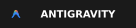

  <h1>Gabriel Cordeiro</h1>
  
<b>Desenvolvedor Full Stack · Web & Mobile</b>

  
TypeScript · Node.js · NestJS · React · React Native · Kotlin Multiplatform

  
  
  
  

---

## Sobre mim

Desenvolvedor **Full Stack** com foco em **Mobile** e **Back-end**. Construo produtos de ponta a ponta: **APIs REST** em **Node.js/NestJS** e **PHP/Laravel**, interfaces em **React** e **Next.js**, e apps **Android e iOS** com **React Native (Expo)** e **Kotlin Multiplatform**, sempre em **TypeScript** quando possível.

No dia a dia trabalho com **plataformas de mobilidade urbana** em produção (apps de motorista e passageiro, painéis administrativos e APIs) e mantenho produtos próprios: duas **extensões open source para VS Code**, um **assistente de IA no WhatsApp** e um **app Android publicado na Play Store**.

Valorizo **arquitetura de software**, **Clean Code**, **SOLID**, **design patterns**, **testes automatizados** (100% de cobertura nos meus projetos), **CI/CD** e **performance**.

 

---

## Stack

  

---

## Projetos em destaque

<table>
  <tr>
    <td align="center" valign="top" width="50%">
       
      
      <h3>Reflect for Android</h3>
      <b>EXTENSÃO VS CODE · OPEN SOURCE</b>
      
  

      
Espelha e controla um celular Android real dentro do VS Code, sem emulador. Inspector de componentes React Native igual ao DevTools do navegador, print e gravação de tela.

      <b>INSTALAR NO</b>    
        
        
        
    </td>
    <td align="center" valign="top" width="50%">
       
      
      <h3>Kit Dev Brasil</h3>
      <b>EXTENSÃO VS CODE · OPEN SOURCE</b>
      
  

      
O 4Devs dentro do VS Code: pessoas e empresas fictícias com CEP, DDD e documentos coerentes, 17 documentos brasileiros, leitura de boleto e PIX de teste com QR code. Tudo offline.

      <b>INSTALAR NO</b>    
        
        
        
    </td>
  </tr>
  <tr>
    <td align="center" valign="top" width="50%">
       
      
      <h3>Tô Lembrado</h3>
      <b>ASSISTENTE PESSOAL · WHATSAPP · APP · ALEXA</b>
      
Manda do jeito que vier: mensagem, áudio, print, PDF ou boleto. Ele entende, organiza em compromisso, lembrete ou conta e te avisa na hora, no WhatsApp, no celular, no relógio e na Alexa.

       
         
      
        
        
        
    </td>
    <td align="center" valign="top" width="50%">
       
      
      <h3>RidePromo</h3>
      <b>APP ANDROID · PLAY STORE</b>
      
Integra com apps de corrida usando Accessibility Service: lê em tempo real o que aparece na tela e aplica descontos automaticamente.

       
        
        
        
    </td>
  </tr>
</table>

---

## GitHub

  
  

---

<i>"It is not the programming language that defines the programmer, but their logic."</i>

